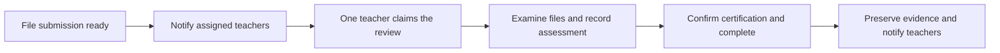
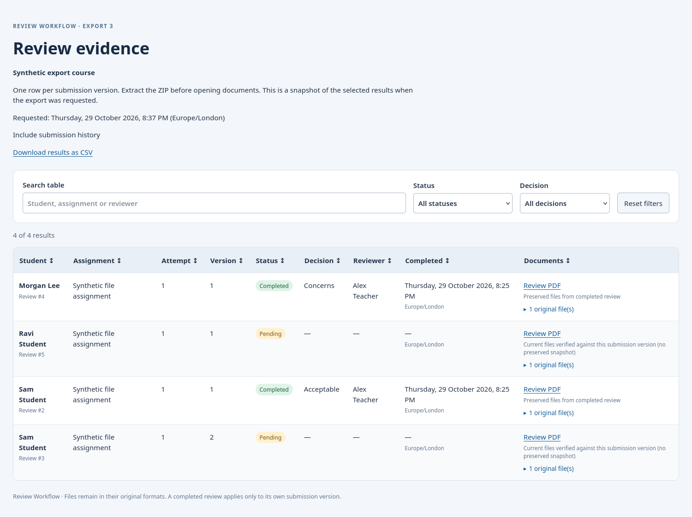

# Review Workflow for Moodle

Review Workflow is a Moodle local plugin for organising and documenting staff
reviews of student submissions. It records who reviewed a particular submission,
what they decided, and the certification they confirmed. It also provides a course
overview and downloadable evidence packages for subsequent examination or audit.

The plugin is intended for situations where several teachers may be eligible to
review a student's work, but one completed review is sufficient. A teacher may
review several students, and a student may have several assigned teachers. These
relationships are configured directly; a separate Moodle group for every student
is not required.

**Current version: 0.4.0.** This is an alpha release. It has been tested with
synthetic submissions, including a 300-review export, but has not been validated
for institutional production use. The implemented integration is the standard
Moodle file assignment. Turnitin support is planned and is not included.

## Contents

- [Purpose and scope](#purpose-and-scope)
- [Requirements](#requirements)
- [Installation and upgrades](#installation-and-upgrades)
- [Setting up an assignment](#setting-up-an-assignment)
- [Assigning reviewers](#assigning-reviewers)
- [The teacher's review](#the-teachers-review)
- [Submission attempts and versions](#submission-attempts-and-versions)
- [Notifications and email templates](#notifications-and-email-templates)
- [Dashboard and filters](#dashboard-and-filters)
- [CSV and evidence packages](#csv-and-evidence-packages)
- [Roles and permissions](#roles-and-permissions)
- [Cron and background processing](#cron-and-background-processing)
- [Evidence retention and privacy](#evidence-retention-and-privacy)
- [Operational limitations](#operational-limitations)
- [Troubleshooting](#troubleshooting)
- [Development, tests and packaging](#development-tests-and-packaging)
- [Version history](#version-history)
- [Author and licence](#author-and-licence)

## Purpose and scope

The review is a separate record from Moodle's assignment grade and feedback. It
can be used to document an academic integrity assessment or a related staff
certification process. The plugin does not determine whether misconduct has
occurred. The teacher examines the submitted material and records their judgement
under the institution's procedures.

The current workflow is:



Only explicitly enabled assignments are monitored. A submission becomes ready
when Moodle records it as **submitted for assessment**, with at least one uploaded
file. A saved draft does not qualify. Review content is restricted to staff.

The assignment's grades, submissions and existing feedback remain unchanged.
There is no modification to Moodle's assignment module or to a Turnitin plugin.
Activity-specific code resides in adapters within this plugin.

## Requirements

| Component | Requirement or validation status |
|---|---|
| Moodle | Minimum version 5.1, enforced by the plugin version file |
| PHP | A version supported by the Moodle installation; tested with PHP 8.3 |
| Database | Moodle's database layer is used; release 0.4.0 was tested with PostgreSQL 15 |
| Assignment | Standard individual assignment with file submissions enabled |
| Groups | Group mode must be **No groups**; team submissions are unsupported |
| Scheduler | Moodle cron, normally invoked every minute |
| Email | Working Moodle messaging and site mail configuration |
| PDF and ZIP | Moodle's bundled PDF library and file packer |

No separate document-conversion service, JavaScript package manager, or additional
plugin dependency is required. Online-text submissions are not captured. Where an
assignment permits both files and online text, this plugin handles its uploaded
files only.

## Installation and upgrades

Site-administrator access is required to install the plugin.

### Install from a plugin ZIP

1. Obtain a packaged plugin ZIP, or build one as described under
   [Packaging](#packaging).
2. Open **Site administration → Plugins → Install plugins**.
3. Upload the ZIP and complete Moodle's validation and installation steps.
4. Complete the database upgrade when Moodle requests it.
5. Check that Moodle cron and email delivery are working.

The installation directory must be `local/reviewworkflow`. The Moodle component
name is `local_reviewworkflow`.

### Install from source

From the Moodle installation directory:

```sh
git clone https://github.com/asselapathirana/moodle-local_reviewworkflow.git local/reviewworkflow
php admin/cli/upgrade.php --non-interactive
```

Run the upgrade using the deployment's normal web-server account. In a container
installation, execute it inside the Moodle application container. Check the paths
against the Moodle installation layout.

### Upgrade an existing installation

Back up the Moodle database and file storage, replace the plugin code with the
newer version, then run Moodle's normal upgrade. A newer packaged ZIP can also be
uploaded through **Install plugins**, where Moodle permits this.

**Do not uninstall before upgrading.** Uninstalling removes the plugin's stored
configuration and review records. An upgrade preserves the existing mappings,
reviews and notification history. Customised scheduled-task settings are retained.

Version 0.4.0 adds export records and an evidence-capture timestamp. It does not
reconstruct historical files that are no longer available. Reviews completed
before evidence preservation was introduced may therefore have no preserved
snapshot.

## Setting up an assignment

Open the course's **Review Workflow** navigation entry. The course dashboard is
also available at:

```text
/local/reviewworkflow/index.php?courseid=COURSE_ID
```

1. Select **Configure** for the required assignment.
2. Enable monitoring.
3. Decide whether existing submitted work should be included in review requests.
   This initial choice is retained once the assignment is configured.
4. Enter the reviewer instructions and certification statement.
5. Configure the request and completion email templates if the defaults need to
   be changed.
6. Save the settings, then assign reviewers.

For example, the certification could read:

> I certify that I have examined the submitted files and recorded my assessment.

The statement is configurable per assignment. The exact wording confirmed by the
teacher is retained with the completed review. If the wording changes while a
teacher has the form open, completion is rejected until the updated statement is
reviewed and confirmed.

For an initial check, use **Check this course now**. This checks that course only;
it does not scan unrelated courses.

## Assigning reviewers

Reviewer mappings belong to an individual assignment. Each student can have one
or more eligible teachers, and a teacher can be assigned to several students.
Missing mappings are shown explicitly.

The **Reviewers** page supports per-student selection and bulk changes. Eligible
reviewers must have an active course enrolment, native assignment grading access,
the plugin's review permission, and visibility of the activity. Student enrolment
and submission eligibility are checked too. Mapping someone does not grant them
additional Moodle file-access permissions.

### Import mappings from CSV

Use **Import reviewers from CSV** on the assignment's Reviewers page. Select
**Email** or **Username** explicitly. Existing accounts and course enrolments must
already be present; the importer does not create accounts or enrol users.

For email addresses:

```csv
student_email,teacher1_email,teacher2_email
student1@example.org,teacher1@example.org,teacher2@example.org
student2@example.org,teacher1@example.org,
```

For usernames:

```csv
student_username,teacher1_username,teacher2_username
student1,teacher1,teacher2
student2,teacher1,
```

Generic column headings `student,teacher1,teacher2` also work with the selected
identification mode. Additional numbered teacher columns can be used. Blank
teacher cells are ignored.

| Import mode | Effect |
|---|---|
| **Add** (default) | Keep existing mappings and add missing student–teacher pairs |
| **Replace** | Treat the file as the complete mapping for this assignment; omitted mappings are removed |

The preview shows resolved accounts, additions, removals and any affected claims.
No mappings change until confirmation. Replace applies to the whole assignment,
including students omitted from the file. A header-only replacement is rejected;
an explicit student row with blank teacher cells can clear that student's mapping.

Unknown or ambiguous identifiers, ineligible users, duplicate student rows, and
malformed CSV block the entire import. Repeated teacher cells produce a warning
and are collapsed into one mapping. Removing a teacher who holds a review claim
requires separate confirmation to release it. Completed reviews and notification
history remain intact.

Files must use UTF-8, comma-separated CSV. Limits are 1 MiB, 10,000 student rows
and 100 teacher columns. Identifiers are matched case-insensitively and must
resolve uniquely. Previews belong to their creator and assignment, expire after
30 minutes, and are revalidated before application.

### Export mappings and inspect history

**Export CSV (emails)** and **Export CSV (usernames)** download the current mapping,
including active students with no assigned teacher. Formula-leading identifiers
are escaped for spreadsheet safety; the importer understands that escaping when
the file is imported again.

**Import history** records who applied an import, when, its mode, and the mappings
added or removed. It retains account identifiers and a file hash rather than a
permanent copy of the uploaded CSV. Mapping import, export and history use the
workflow-management permission.

## The teacher's review

A teacher follows the notification link or opens the course dashboard, then:

1. Selects **Start review** to claim an available request.
2. Examines the submitted files and the assignment's review instructions.
3. Records a decision and comments. Drafts can be saved without completing the
   review.
4. Confirms the certification statement and completes the review.

The available decisions are **Acceptable**, **Concerns**, and **Further
investigation**. A decision and certification are required for completion.

A claim prevents another teacher from taking over the same review. A workflow
manager can release an unfinished claim when reassignment is needed. Once one
assigned teacher completes the review, the shared requirement is satisfied; the
other assigned teachers do not each have to submit another assessment.

Completed review content is retained as history. The normal interface does not
reopen or overwrite it. Subsequent submission changes create a new review record.
Privacy erasure may remove personal data through Moodle's Privacy API.

## Submission attempts and versions

Moodle attempts and submission versions are related but distinct. A student can
change files within the same Moodle attempt. The plugin identifies evidence using
the submission, attempt and uploaded-file manifest, including file content hashes.
A timestamp change alone does not create another review request.

Each detected submission version is a separate row. There are no nested review
rows.

| Situation | Latest-only view | History view |
|---|---|---|
| Original submission has a completed review | Completed review | Completed review |
| Student submits revised files after that review | New version, pending review | Earlier completed row and new pending row |
| Revised version is subsequently reviewed | New completed review | Both completed versions, with their own evidence |

Latest-only selection happens **before** status and decision filters. Selecting
“Reviewed” will not bring back an older approval when the latest version is still
pending. “Not yet reviewed” means pending or in progress. Superseded historical
versions have their own status.

The dashboard covers detected submitted-file versions. A student who has not
submitted anything does not appear as a pending review. Changes made and reversed
between scheduled scans cannot be reconstructed by polling.

## Notifications and email templates

Two types of notification are used:

- A **review request** when qualifying evidence is detected for an assigned teacher.
- A **completion notice** naming the teacher who completed the shared review.

Completion notices go to all currently eligible mapped teachers, including the
completing teacher. Draft saves do not produce completion notices. Initial
requests still waiting to be sent are skipped after completion. Upgrading does
not send completion messages retrospectively for old completed reviews.

Both use Moodle messaging and the site's email settings. The message-provider
preferences for requests and completion notices are separate.

### Template settings

Each monitored assignment has an editable subject and body for both email types.
Use **Preview emails** to inspect substitutions with synthetic example values.
Preview does not save settings or send email. **Restore default emails** fills the
editors; **Save changes** is still required to apply them.

| Placeholder | Meaning | Availability |
|---|---|---|
| `{reviewer_firstname}` | Recipient's first name | Both email types |
| `{reviewer_name}` | Recipient's full name | Both email types |
| `{student_name}` | Student's full name | Both email types |
| `{course_name}` | Course name | Both email types |
| `{assignment_name}` | Assignment name | Both email types |
| `{review_link}` | Labelled Moodle review link | Message bodies only |
| `{assignment_link}` | Labelled, bracketed optional assignment link | Message bodies only |
| `{completed_by}` | Completing teacher's name | Completion templates only |
| `{completed_at}` | Completion time in the recipient's timezone | Completion templates only |

Example request body:

```text
Dear {reviewer_firstname},

{student_name} has submitted files for {assignment_name} in {course_name}.

Please examine the files and record your assessment and certification.
One completed review by an assigned teacher is sufficient.

{review_link}

{assignment_link}
```

Templates are plain text. Subjects must be nonempty single lines of at most 255
characters; bodies may contain up to 10,000 characters. Unknown or malformed
placeholders, link placeholders in subjects, and repeated link placeholders are
rejected. Missing links are appended automatically. Completion messages always
identify the completing teacher, even if that placeholder was omitted.

The latest saved template is used when the message is delivered. Changes therefore
affect queued messages, but do not alter messages already sent. Default emails do
not include assessment comments, decisions or certification text.

### Duplicate prevention and delivery status

A persistent ledger identifies each message by review version, recipient and
notification type. Database uniqueness and a shared Moodle lock prevent repeated
or overlapping scans from sending the same notice again.

| Status | Meaning |
|---|---|
| Queued | Waiting for processing |
| Processing | Delivery processing has started |
| Accepted | Moodle messaging accepted the message; this is not proof of inbox delivery |
| Skipped | The request or recipient was no longer eligible for delivery |
| Uncertain | Delivery could not be confirmed; investigate before attempting a resend |

Uncertain outcomes are not blindly retried. Restoring a removed mapping does not
automatically resend a previously skipped or uncertain message. Automatic
reminders are not implemented.

## Dashboard and filters

The course dashboard provides monitoring settings, review-status counts and a
paginated results table. Filters are shared with result downloads:

| Filter | Interpretation |
|---|---|
| Assignment | One assignment, or all accessible assignments in the course |
| Review status | Reviewed, not yet reviewed, pending, in progress, or superseded |
| Decisions | One or more selected decisions; either choice can match |
| Student | Student name or username search |
| Actual reviewer | Name or username of the claiming or completing teacher |
| Completion dates | Inclusive start/end dates in the requester's Moodle timezone |
| Include submission history | Earlier versions become additional rows |

Different filters are combined. For example, selecting two decisions and a date
range returns records matching either decision **and** that range. With no other
filters, all accessible latest versions are shown. Enable history to include all
recorded versions too.

The dashboard displays 50 rows per page. Downloads include every matching row,
not just the displayed page. Reviewer search does not mean all teachers eligible
to review an unclaimed submission; it refers to the actual recorded reviewer.

## CSV and evidence packages

### Filtered CSV

**Download filtered CSV** exports the selected result set. It includes review ID,
student, assignment, Moodle attempt, submission version, status, decision,
reviewer, completion time, timezone, comments, certification and evidence status.
Formula-leading values are neutralised for spreadsheet use.

### Background ZIP export

Select **Prepare filtered ZIP**. Moodle queues an adhoc task and opens **My export
packages**, where the requester can refresh progress and download the package
when it is ready. The selected rows and assessment details are frozen at request
time; subsequent submissions are not silently added to that package.

The archive has this structure:

```text
index.html
results.csv
style.css
table.js
reviews/
  review-123/
    review.pdf
    files/
      456-original-document.docx
  review-124/
    review.pdf
    files/
      457-original-submission.pdf
```

Extract the ZIP, then open `index.html`. Its table supports offline search,
status/decision filters and sortable columns. Document links are relative to the
extracted package, so navigation does not depend on an active Moodle session.
Styles and scripts are included locally; there is no external CDN dependency.



Each review PDF contains the student, course, assignment, attempt/version, status,
reviewer, decision, assessment comments, certification and relevant dates with
timezone. Uncompleted reviews are explicitly identified as drafts. Original files
remain in their submitted formats; the plugin does not convert them to PDF.

Where original evidence is unavailable, the HTML, PDF and CSV say so. Newer files
are not substituted for an older version. Links inside a PDF depend on the PDF
viewer; the HTML index is the primary way to navigate the package.

### Package access and expiry

ZIPs are available only to the user who requested them. Export permissions and
native assignment access are checked during request, build, publication and
download. A ready package cannot be downloaded after the relevant permission is
revoked.

Downloads expire seven days after the request. An hourly cleanup task removes
expired archives and their selected-row data. Minimal expired-job information
remains for status display. Package expiry does not delete the preserved files
associated with completed reviews.

## Roles and permissions

Permissions are capability-based. The plugin does not require a role with a
particular name, such as “Coordinator”.

| Capability | Purpose | Default role grants |
|---|---|---|
| `local/reviewworkflow:manage` | Configure monitoring, manage mappings and release unfinished claims | Manager, Teacher (editing) |
| `local/reviewworkflow:review` | Participate as an assigned reviewer | Teacher (editing), Non-editing teacher |
| `local/reviewworkflow:export` | Download result CSVs and evidence ZIPs | Manager only |

Site administrators have normal Moodle administrator access. The table describes
default grants; effective permissions also depend on enrolment, context overrides,
activity visibility and native assignment capabilities. Having a review permission
alone does not provide access to every student's review.

### Grant exports to a custom Coordinator role

An administrator can edit the institution's Module/Course Coordinator role under
**Site administration → Users → Permissions → Define roles**, or use an
appropriate context override. Allow **Export review results and submission
evidence** (`local/reviewworkflow:export`) for that role.

The user also needs course access, visibility of the relevant activity, and native
assignment grading permission. The export permission is separate from workflow
management: a role need not be permitted to change reviewer mappings in order to
export accessible evidence.

Editing and Non-editing Teachers do not receive result-export access by default.
Reviewer-mapping CSV export uses the management capability and is a different
operation from exporting review results and student evidence.

## Cron and background processing

Use Moodle's normal cron. A typical invocation from the Moodle root is:

```sh
php admin/cli/cron.php
```

The administrator should arrange for this to run every minute using the correct
application account and deployment environment. The plugin does not install a
host cron entry or change system services.

| Task | Default schedule | Purpose |
|---|---|---|
| Detect submissions and send review requests | Minute 17 each hour | Detect ready versions and deliver queued notices |
| Delete expired review export packages | Minute 43 each hour | Remove expired packages and selection data |
| Build export package | Adhoc, after a request | Prepare the selected ZIP in the background |

The scan frequency can be changed through **Site administration → Server → Tasks
→ Scheduled tasks**. For every-minute scanning, set Minute, Hour, Day, Month and
Day of week to `*`, and leave the task enabled. Customised schedules survive normal
plugin upgrades.

More frequent scans reduce the delay between submission and notification. They
still inspect Moodle's local submission information; the current adapter does not
call Turnitin or refresh an external report. The notification ledger prevents
repeat notices when scan frequency increases.

In a container deployment, cron must run inside the application environment with
access to the same database, configuration, plugin code and Moodle file storage.
Include the plugin code in the deployment image or an appropriate persistent
volume; files uploaded into a disposable container alone can disappear on a
redeploy.

## Evidence retention and privacy

From version 0.4.0, successful completion preserves the exact original uploaded
files through Moodle's File API. The evidence version is checked before and after
copying. Review completion, snapshot file metadata, audit entry and completion
notification records are committed together. A failed completion does not leave a
completed review with an incomplete snapshot.

Moodle's content-addressed file storage can share identical file content between
the original submission and the preserved reference. Retaining that reference
allows the reviewed evidence to remain available if the live submission changes.

Earlier completed reviews are not automatically backfilled. Where no snapshot
exists, current files are used only if their evidence hash still matches the
recorded version. If the files have changed, the original evidence is marked
unavailable.

The plugin implements Moodle privacy metadata, discovery, export and erasure for
its stored records. Student snapshots are included in the relevant privacy export.
Erasure removes affected snapshots and invalidates whole generated packages
containing that participant. It cannot delete copies that someone has already
downloaded outside Moodle; those require the institution's own handling procedures.

Completed-review evidence remains with the review history unless removed through
privacy handling or plugin uninstallation. Temporary package expiry is a separate
policy from retention of the underlying academic review record.

## Operational limitations

- Turnitin, online-text evidence, group-mode assignments and team submissions are
  not supported in this release.
- Course backup/restore integration for the plugin's records is not implemented.
  A course backup should not be treated as a complete backup of review history.
- The review decisions are currently the three built-in options. Instructions,
  certification and email templates are configurable; the decision list is not.
- There are no automatic reminders, student-facing review pages, or normal UI
  controls to edit completed assessments.
- Polling records detected versions, not every intermediate edit between scans.
- Old evidence cannot be reconstructed once the corresponding files are gone.
- Native file permissions continue to apply. Mapping or granting an export
  capability does not override native assignment grading or activity visibility.
- A successful Moodle messaging result does not establish that an email reached
  the recipient's inbox.
- ZIP preparation needs temporary disk space as well as final file storage. Large
  submissions can make packages substantially larger than the review PDFs alone.
- English language strings are included. Additional language packs can be added.

## Troubleshooting

| Observation | Checks |
|---|---|
| No review appears after upload | Confirm monitoring is enabled, the submission is submitted rather than draft, uploaded files are present, and the activity is supported |
| Existing submissions are absent | Check the initial include/exclude choice; excluded baseline versions are not automatically reopened |
| A review appears but no teacher is notified | Check reviewer mappings, active enrolment, grading/review permissions, cron and Moodle messaging preferences |
| The dashboard shows “Accepted”, but no email arrives | Check Moodle's mail configuration and the receiving mail system; acceptance is not inbox confirmation |
| Notification status is uncertain | Investigate the send outcome before resending; automatic retries are intentionally suppressed |
| A teacher cannot claim a review | Check their mapping and permissions, current evidence, and whether someone else holds the claim |
| Certification cannot be completed | Reload the form and confirm the current wording; it may have changed since the form was opened |
| Export buttons are missing | Check the separate export capability; editing-teacher status alone does not grant it |
| Export remains queued | Check Moodle cron and adhoc-task execution, not just the submission-scan task |
| Export fails | Recheck requester permissions and activity availability, inspect the server task logs, then request a new export |
| Evidence is unavailable in a historical row | A matching current version or preserved snapshot is required; the plugin does not substitute revised files |
| HTML document links do not work | Extract the complete ZIP before opening `index.html`; preserve its directory structure |
| Installation or removal reports a directory-permission error | Check ownership and writability of Moodle's relevant directories using the deployment's application account |

Use synthetic accounts and files for initial testing. Test assignment submission,
claim, draft, certification, completion, notification deduplication, resubmission
and evidence export before enabling the workflow for real academic records.

## Development, tests and packaging

The plugin follows Moodle's normal directory structure. Relevant implementation
areas are:

| Location | Responsibility |
|---|---|
| `classes/adapter/` | Activity-specific submission readiness and evidence discovery |
| `classes/workflow.php` | Configuration, mappings, review lifecycle and notification accounting |
| `classes/evidence.php` | Preserved original-file snapshots and access checks |
| `classes/report_query.php` | Shared filtering and version selection |
| `classes/exporter.php` | CSV, export jobs, package ownership and expiry |
| `classes/export_document.php`, `export_assets/` | Review PDFs and the offline HTML table |
| `classes/task/` | Scheduled and adhoc task entry points |
| `classes/privacy/` | Privacy metadata, discovery, export and erasure |
| `db/` | Schema, upgrades, capabilities and task/message registration |
| `tests/` | Synthetic Moodle PHPUnit integration tests |

The adapters are part of this plugin. Future integrations should provide their own
readiness and evidence handling while preserving the shared access controls,
review lifecycle and notification guarantees. Turnitin readiness, report launch,
report export and grade preservation still require institutional integration tests.

### Tests

Use a dedicated non-production Moodle test environment with its PHPUnit database
and dataroot configured. From the Moodle root:

```sh
php public/admin/tool/phpunit/cli/init.php
vendor/bin/phpunit --test-suffix _test.php public/local/reviewworkflow/tests
```

These paths match the Moodle 5.1 development layout used for validation. Adapt
paths to the checkout where necessary. Do not initialise or run these tests against
an operational Moodle database. See [Testing and validation](docs/testing.md) for
scope and results.

Release 0.4.0 passed **62 tests and 298 assertions** on Moodle 5.1.8+, PHP 8.3.36
and PostgreSQL 15.18. Browser checks covered filters, CSV, historical evidence,
actual adhoc-task execution, permissions and offline navigation. A synthetic
300-review history package produced one ZIP under concurrent builders, with 300
review PDFs, 300 HTML rows and the complete CSV. It took approximately 33 seconds
in that local environment; this is not a production throughput guarantee.

### Packaging

The optional packaging script uses Python's standard library only:

```sh
python3 scripts/package.py
```

It creates `build/reviewworkflow.zip` with the correct `reviewworkflow/` directory
name. This is the installable plugin ZIP; GitHub's source archive has a different
outer directory name. Build output is not tracked in Git.

## Version history

The public repository retains separate source commits and tags for the available
implemented versions:

| Version | Main changes |
|---|---|
| 0.1.2 | File-assignment monitoring, reviewer mappings, claims, structured reviews, certification and persistent notification accounting |
| 0.2.1 | Preview-first reviewer CSV import, mapping export and import history |
| 0.3.0 | Customisable email templates, preview/default restoration and completion notices |
| 0.4.0 | Shared result filters, CSV and background evidence ZIPs, original-file snapshots, configurable export permission and package expiry |

See [CHANGELOG.md](CHANGELOG.md) for release details. Earlier intermediate patch
states are not presented as separate reconstructed releases where a corresponding
source snapshot was not retained.

## Author and licence

Developed by **Assela Pathirana**.

Copyright © 2026 Assela Pathirana. Licensed under
[GNU General Public License, version 3 or later](LICENSE).
